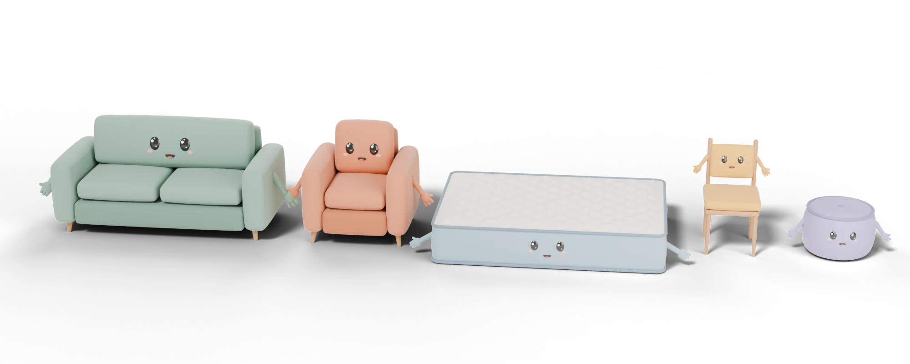

# BLISS — выездная химчистка мягкой мебели

Веб-приложение: клиент выбирает мебель, видит примерную стоимость и оставляет заявку; владелец согласует цену и выезд в кабинете. Шаблон, который можно адаптировать под другую компанию.

- Задание: [`docs/PROMPT.md`](docs/PROMPT.md)
- Разбор и решения (формула цены, хранение, безопасность, порядок работы): [`docs/PLAN.md`](docs/PLAN.md)

## Статус

Готово:

- каталог мебели и формула расчёта цены с тестами (`src/lib/pricing`);
- 3D-персонажи мебели (диван, кресло, матрас, стул, пуф «Другое») с лицами, руками, морганием и приветствием: GLB в `public/models`, постеры в `public/posters`, исходник `.blend` и сборочный скрипт в `blender/`. Подробности — [`docs/ASSETS.md`](docs/ASSETS.md);
- первый экран — конфигуратор: выбор категории, варианта, количества и надбавок с примерной ценой по формуле заявки, рядом 3D-сцена (вращение, сброс ракурса, приветствие и реплика, постер без WebGL и при ошибке загрузки);
- корзина на главной: несколько предметов, одинаковые позиции объединяются, можно менять количество и параметры («Изменить» возвращает позицию в выбор), удалять с отменой; хранится в браузере и переживает перезагрузку;
- оформление заявки `/oformlenie`: черновик формы сохраняется, до 3 фото (сжатие в браузере и на сервере, повтор загрузки, удаление), ошибки рядом с полями;
- сервер заново проверяет заявку и считает цену, сохраняет снимок прайса; повтор с тем же ключом не создаёт дубль;
- приватная ссылка `/z/<токен>`: состав, статус, цена, время, фото, история; страница сама обновляется;
- база PostgreSQL (локально — PGlite без установки), ограничение частоты запросов, проверка Origin;
- кабинет владельца `/admin`: заявки (поиск, фильтры, обновление, звонок/WhatsApp, фото, состав, расчёт, история), согласование цены и времени, статус, приватная заметка, удаление с подтверждением; «Тарифы», «Компания» (название, контакты, город, территория, акцентный цвет), «Доступ» (смена пароля закрывает прочие сеансы, выход);
- политика конфиденциальности (шаблон), источники и лицензии, светлая и тёмная темы по настройке устройства.

Пока **нет**: мини-игры с пятнами и разделов кабинета «Игра» и «Персонажи», PWA, sitemap/robots, макетов в Figma.



## Кабинет

Откройте `/admin`. Пароль задаётся переменной `ADMIN_PASSWORD` (см. `.env.example`); в `npm run dev` без неё — `bliss-demo`.
После смены пароля в разделе «Доступ» действует новый пароль из базы, а `ADMIN_PASSWORD` больше не нужна.

## Валюта

Сейчас цены в тенге (₸). Чтобы перейти на турецкие лиры (₺), откройте `src/lib/company.ts` и замените

```ts
export const CURRENCY: CurrencyCode = "KZT";
```

на

```ts
export const CURRENCY: CurrencyCode = "TRY";
```

Демо-цены для обеих валют лежат в `src/lib/pricing/price-list.ts`.

## Запуск

Нужен Node.js 22 или новее.

```bash
npm install
npm run dev        # сайт на http://localhost:3000
```

База: без настроек используется PGlite (настоящий Postgres внутри процесса), данные лежат в `.data/pglite`.
Для хостинга укажите `DATABASE_URL` (см. `.env.example`) — таблицы создадутся сами при первом запросе.
После изменения схемы (`src/server/db/schema.ts`) выполните `npm run db:generate`.

Проверки:

```bash
npm test           # тесты формулы, приёма заявки, фото
npm run typecheck  # типы
npm run lint
npm run build      # сборка
```

## Стек

Next.js 16 (App Router, Cache Components), React 19, TypeScript, zod, Three.js + React Three Fiber + Drei, Drizzle ORM + PostgreSQL / PGlite, sharp, Vitest. Модели — Blender (`blender/`).
