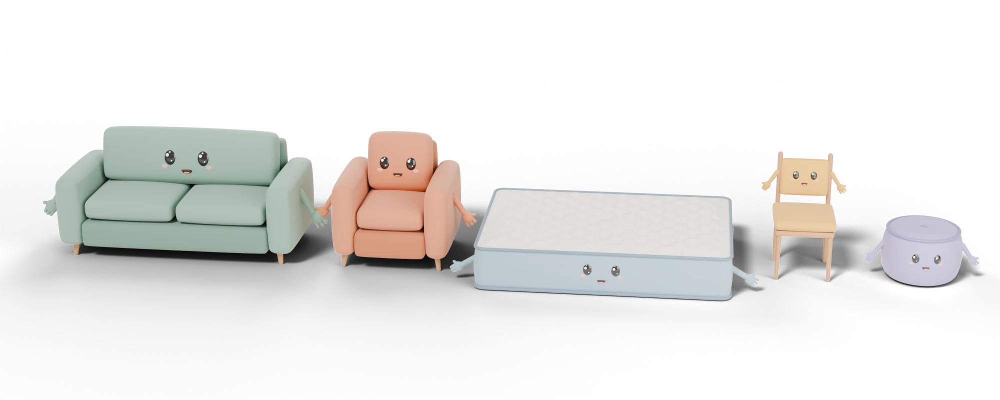

# 3D-ассеты BLISS



## Что есть

| Категория | Модель для сайта | Постер | Персонаж | Треугольники | GLB (сжатый) |
| --- | --- | --- | --- | ---: | ---: |
| Диван | `public/models/sofa.glb` | `public/posters/sofa.webp` | шалфейный, две подушки сиденья, лицо на спинке | 31 016 | ≈ 324 КБ |
| Кресло | `public/models/armchair.glb` | `public/posters/armchair.webp` | терракотовое, высокие подлокотники | 27 944 | ≈ 292 КБ |
| Матрас | `public/models/mattress.glb` | `public/posters/mattress.webp` | стёганый верх «ромбом», боковая лента, канты, ручки на торцах; лицо на ленте | 23 996 | ≈ 190 КБ |
| Стул | `public/models/chair.glb` | `public/posters/chair.webp` | дубовый каркас, горчичные сиденье и спинка | 18 728 | ≈ 172 КБ |
| Другое | `public/models/other.glb` | `public/posters/other.webp` | круглый пуф с пуговицей и кантом | 13 640 | ≈ 128 КБ |

Исходник: `blender/bliss_characters.blend` — все пять персонажей в отдельных коллекциях `BLISS_<категория>`, свет, камера и пол для постеров.

Одна модель на категорию. Варианты («2 места», «угловой», «реклайнер», «двуспальный»…) меняют только тариф, модель не перестраивается.

## Происхождение и права

Все модели сделаны с нуля для этого проекта скриптом `blender/build_characters.py`: геометрия процедурная, текстур нет. Сторонние модели, сканы, текстуры и шрифты не использовались, поэтому чужих лицензий и атрибуций у ассетов нет. Права на них — у владельца проекта; модели можно использовать коммерчески и передавать вместе с исходниками.

Инструменты: Blender 5.3 (через модуль `bpy`, в облачной среде Claude Code) и gltf-transform 4.2 (MIT) для сжатия. Лицензия GPL у Blender относится к самой программе, а не к созданным в ней файлам.

## Устройство модели (для подключения на сайте)

- **Координаты**: метры, ось Y вверх, лицом к +Z (туда по умолчанию смотрит камера three.js). Модель стоит на y = 0 и отцентрована по X и Z.
- **Узлы**: корень `BLISS_<категория>`; его `userData` содержит `bliss_category` и `bliss_clips`. Кости: `body`, `eye_L`, `eye_R`, `mouth`, `arm_L`, `hand_L`, `arm_R`, `hand_R`. `_L` — левая рука персонажа, на экране она справа.
- **Якоря-пустышки**:
  - `anchor_face` — центр лица: реплика не должна его закрывать;
  - `anchor_bubble` — точка над головой: к её проекции на экран привязывается реплика.
- **Клипы**:

  | Клип | Длина | Кости | Как играть |
  | --- | --- | --- | --- |
  | `Idle` | 4 с | `body` (лёгкое «дыхание») | по кругу |
  | `Blink` | 0,3 с | `eye_L`, `eye_R` | один раз, раз в 3–7 с в случайный момент |
  | `Wave` | 2 с | `arm_L`, `hand_L`, `mouth` | один раз при появлении персонажа |

  Клипы не трогают одни и те же кости, поэтому все три можно проигрывать одновременно без настройки весов. При `prefers-reduced-motion` достаточно оставить статичную позу.
- **Материалы**: PBR. Ткань с sheen, дерево и глаза с clearcoat — в three.js получаются `MeshPhysicalMaterial`. Блик в глазах слегка светится, чтобы лицо читалось в тёмной теме.
- **UV**: у тканевых поверхностей (материалы `*_fabric`, `mattress_top`, `mattress_band`, `pouf_fabric`) развёртка без перекрытий (Smart UV Project). Это заготовка для игры с пятнами: raycast, затем UV, затем маска.
- **Сжатие**: `EXT_meshopt_compression` и `KHR_mesh_quantization`. `useGLTF` из drei распаковывает это сам. В чистом three.js нужен `GLTFLoader().setMeshoptDecoder(MeshoptDecoder)`.
- **Постеры**: 900×900, WebP с прозрачным фоном и тенью. Нужны для показа без WebGL и как заглушка, пока модель загружается.

## Проверки

- **Руки не заходят в корпус и в пол.** Скрипт проверяет позу покоя и каждый второй кадр `Wave`:
  - кисть не пересекает корпус и другие детали (пересечение треугольников через BVH);
  - ось руки не подходит к поверхности ближе 3 мм;
  - кисть всегда выше пола.

  Минимальные зазоры по последней сборке:

  | Персонаж | Рука L (машет) | Кисть L | Рука R | Кисть R |
  | --- | ---: | ---: | ---: | ---: |
  | Диван | 1,3 см | 7,3 см | 1,3 см | 7,4 см |
  | Кресло | 1,0 см | 6,1 см | 1,0 см | 6,1 см |
  | Матрас | 1,5 см | 5,7 см | 2,3 см | 10,5 см |
  | Стул | 1,1 см | 3,8 см | 1,1 см | 4,4 см |
  | Другое | 1,2 см | 4,2 см | 1,2 см | 5,3 см |

  Зазор руки считается от поверхности её оси до корпуса, на участке от середины руки до запястья: у плеча рука намеренно входит в корпус.

- **Загрузка в браузере.** Сжатые и несжатые GLB загружены в three.js r180 в headless Chromium. У всех пяти моделей есть клипы `Idle`, `Blink`, `Wave`, якоря и `userData`. Поза при `Wave` и `Blink` совпадает с Blender, сжатая версия выглядит так же, как исходная, ошибок в консоли нет.
- **Не проверено**: реальный телефон и скорость на слабом устройстве. Это нужно сделать, когда сцена появится на сайте.

## Как пересобрать и править

Нужен Blender 4.4 или новее (проверено на 5.3) и Node.js для сжатия.

Пересобрать всё с нуля: персонажи, `.blend`, GLB и постеры (рендер на CPU займёт несколько минут):

```bash
blender -b -P blender/build_characters.py
```

```bash
sh blender/optimize.sh
```

Флаги после `--`: `--no-render` — без постеров, `--draft` — быстрый черновой рендер. Внешний вид персонажей (размеры, цвета, положение лица и рук, углы рук) задаётся в начале скрипта: функции `build_*` и словарь `SPECS`.

Чтобы поправить модель вручную в Blender:

1. Откройте `blender/bliss_characters.blend`. Клипы лежат в NLA-дорожках `Idle`, `Blink`, `Wave` у каждого скелета; дорожки приглушены, чтобы в сцене была поза покоя.
2. После правок экспортируйте и сожмите:

   ```bash
   blender blender/bliss_characters.blend -b -P blender/export_glb.py
   ```

   ```bash
   sh blender/optimize.sh
   ```

Повторный запуск `build_characters.py` пересоздаёт `.blend` с нуля, и ручные правки в нём пропадут. Поэтому выберите один путь: либо правите скрипт, либо `.blend`.

Если у вас подключён Blender MCP, те же скрипты можно выполнить прямо в открытом Blender (вкладка Scripting или команда MCP для запуска кода).
